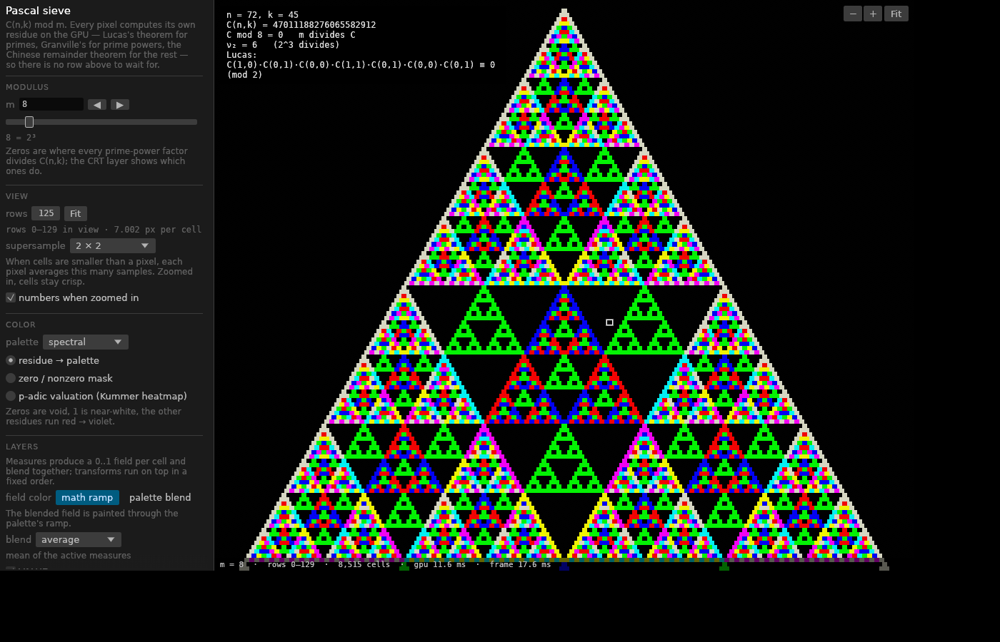

# Pascal triangle explorer

Pascal's triangle modulo *m*, rendered on the GPU. Every pixel computes its own
`C(n,k) mod m` in a shader from a closed form — Lucas's theorem for primes,
Granville's theorem for prime powers, the Chinese remainder theorem for
composites — so there is no row-by-row dependency, no triangle buffer, and the
view can pan and zoom to rows in the hundreds of millions at interactive rates.



The look, palettes, controls and keys follow `reference/pascal-core.html`; the
layer stack (measures blended into a field, transforms on top, two field color
modes) follows the `MAP_MODES` registry of `reference/pascal.html`.

## Build and run

Requirements: a Rust toolchain (stable, via [rustup](https://rustup.rs)) and a
GPU with Vulkan, Metal, DirectX 12 or OpenGL. No other SDKs are needed.

```sh
cargo run --release
```

| Platform | Notes |
| --- | --- |
| **Windows** | Install Rust from rustup.rs (MSVC toolchain). `cargo run --release` uses DirectX 12 or Vulkan. |
| **macOS** | `xcode-select --install` for the linker, then `cargo run --release` (Metal). |
| **Linux** | Needs `libxkbcommon` and a Vulkan or GL driver at runtime, e.g. on Debian/Ubuntu `sudo apt install libxkbcommon-x11-0 mesa-vulkan-drivers`. Wayland and X11 both work. |

Headless rendering (no window), handy for scripts and for machines without a
display:

```sh
cargo run --release -- --export pascal.png --m 30 --rows 256 --palette turbo --size 1920x1080
cargo run --release -- --svg pascal.svg --m 5 --rows 80 --palette ocean --outlines
cargo run --release -- --help
```

`WGPU_BACKEND=vulkan|gl|metal|dx12` forces a backend.

### Troubleshooting

* **Black window, and the driver printed `NVVM compilation failed` (NVIDIA) or a
  similar shader compiler message.** The driver rejected one of the compute
  shaders and lost the device. Run

  ```sh
  cargo run --release -- --check-shaders
  ```

  which compiles every pipeline one at a time and names the ones the driver
  rejects, then retries each failure without naga's runtime-check wrappers
  (index clamps and forced loop bounding, which the shaders do not need because
  they bound every index themselves). If that mode compiles, run the app with
  `PASCAL_UNCHECKED_SHADERS=1`. Please report the output together with the
  driver version. Another backend uses a different shader compiler path:
  `WGPU_BACKEND=gl` on Linux and Windows, or `WGPU_BACKEND=dx12` on Windows.
  Debug info is left out of the SPIR-V by default; `WGPU_DEBUG=1` puts it back
  for graphics debuggers.
* **No adapter found.** Install a Vulkan or GL driver; on Linux without a GPU,
  `mesa-vulkan-drivers` provides a software device that runs the app slowly.
* `RUST_LOG=info` prints the adapter and backend in use.

### Tests

```sh
cargo test
```

`tests/gpu_verify.rs` renders regions of the triangle with the real pipeline,
reads them back and compares every cell with the plain additive rule
(`src/math.rs: triangle_dp`) for primes, prime powers, composites and the edge
moduli 2, 3, 4, 6, 12, 30, 65535, 65536, 65537, 99991, 524288, 999983, 999999,
1000000. It also checks rows near 10⁶, 1.2·10⁸ and 10⁹ against the CPU closed
form, and the measures, blend modes, transforms and resolved colors against CPU
twins. Everything must match exactly (fields to within float rounding).

The tests need a GPU adapter. On a machine without one, Mesa's software Vulkan
driver works: `sudo apt install mesa-vulkan-drivers` (lavapipe) and run
`cargo test`; set `WGPU_BACKEND=vulkan` if another backend is picked up.

## Controls

| Input | Action |
| --- | --- |
| drag | pan |
| wheel / pinch | zoom, centered on the cursor |
| double-click, **F** | fit the chosen number of rows |
| **space** | play / pause the sweep |
| **← / →** | one step back / forward through the sweep's selection mode |
| **PgDn / PgUp** | ten steps back / forward |
| **↑ / ↓** | rows to fit +1 / −1, then fit (with rows following m: the next / previous modulus) |
| **Shift** | ×10 for any of the above |
| hover | inspector: *n*, *k*, `C(n,k)`, `C mod m`, ν_p for each prime factor, the Lucas digit product |
| click a cell | pin its row for the wave overlay (click the row again, or **Esc**, to release) |
| **W** | show / hide the wave overlay (it fades) |
| **F11** | fullscreen: the canvas alone, panel, bars and buttons hidden; **Esc** returns |

Fitting R rows shows exactly rows 0..R−1: the apex on the top edge and row R−1
ending on the bottom edge (a canvas narrower than the triangle's 2 : √3 shows its full
width, and the space below row R−1 stays background while the view is fitted; zoom or
pan and the whole triangle is there again). The status line is a bar of its own
under the canvas, so the canvas is exactly what is in view, and the readouts, the
in-cell numbers and the wave's last-visible-row fallback (the last whole row, never
past R−1 while fitted) agree with it.

The panel on the left has the modulus (text, ◀ ▶, log slider), the rows to fit and
the rows-follow-m link, supersampling, the palette, the three color presets
(residue → palette, zero/nonzero mask, p-adic valuation heatmap), the color offset,
cell outlines and zero glow, the layer stack, PNG and SVG export, and a Reset
button. When cells are at least 18 px wide their residue is printed inside them.

**Rows follow m** (the reference's LINK) parents the row count to the modulus: rows
= m × factor (factor 1 by default: one full period of a prime modulus, whose zero
blocks start at row m), refitted whenever m changes — typed, stepped, slid or swept.
A view you have zoomed or panned keeps its zoom relative to the fit and the same spot
of the triangle as it grows. The link runs both ways: with it on, a row count typed
into the field (applied on Enter) moves the modulus to rows ÷ factor, snapped to the
sweep's selection mode, and ↑/↓ — on the canvas or in the field — step to the next
modulus that way. "Hold rows while sweeping" keeps the count still while the sweep
plays or frame-steps (|◀ ▶|); typed moduli, ◀ ▶ and the arrow keys still move it.
With the rows following, every frame changes the view, so a tween cross-fades instead
of morphing. `--link` turns the link on from the command line.

## From the square scanner

`reference/ChatGPT-version-pascal-square-scanner` is a small canvas page ("Pascal ·
Square Scanner"). These of its features earned a place here:

* **Color offset** (its "fractional offset", −1..1), with its own ▶ / ❚❚: playing,
  it cycles round and round — one full turn per period (4 s by default), wrapping,
  for as long as the button is on. Residue colors slide along
  the palette, cyclically, keeping their spacing — a step of 1/m moves every residue
  one slot, as the scanner's frac(r/m + offset) does, and the top residue waits one
  slot before it wraps to the bottom. Unlike the scanner, the void of 0 and
  spectral's white 1 stay put: zeros are the structure everything here is about (with
  nothing else on the ramp, spectral m = 2 has nothing to move). A single colored
  residue (m = 2) bounces between the ramp's ends. It applies to the residue coloring
  and PALETTE BLEND, on the GPU, so exports carry it.
* **Cell outlines**: the scanner's faint `rgba(235, 238, 250, .12)` outline, as a
  1 px line centred on every cell boundary (zeros included), drawn by coverage so its
  width does not depend on where the boundary falls between pixels.
* **Zero glow** (its glow on residue-0 cells): light in the palette's 0.8 color
  spreads from every zero cell over its neighbours out to min(10 px, 0.8 cell), as the
  scanner's `shadowBlur`. Zero cells receive it from neighbouring zeros too, so a void
  shows a lit lattice, and the light is screen-blended, so it only ever brightens.
  Zeros just off the canvas still cast it (their residues come from the closed form).
* Outlines and glow are drawn by the resolve pass, so exports include them; they
  fade in as cells grow from 3 to 6 px and vanish when zoomed out. Both start off, so
  the default view stays identical to `pascal-core.html`.
* **Palettes** Ember, Ocean and Moss (its four-stop gradients).
* **SVG export** (its "Save SVG"): rows 0..R−1 (the rows setting, up to 1024) as
  vector cells — one path per color, and with outlines on, one stroked path over all
  cells — for the residue, mask and valuation colorings, which the CPU reproduces.
  From the window the valuation is normalized by the max ν of the cells in view, so
  the file matches the screen pixel for pixel (verified against the GPU on a fitted
  view); `--svg` on its own normalizes over the exported rows. The glow is a raster
  effect and stays out.
* **Reset**: every setting back to the app's defaults (outlines and glow off).

Left out: its BigInt coefficients (the closed form here is exact at any row), the
square-cell geometry and cell-scale slider (cells here keep the √3/2 lattice the
neighbour measures rely on; zoom sets the scale), the 2–31 modulus slider, the page
chrome, and its motion modes (only "pulse" animates there — "down" and "up" are
static ramps — and the sweep already moves the picture). Its README names an atlas,
determinant motion and a Lava renderer from the original site that the
reconstruction does not contain, so there was nothing to port.

## Modular wave

A translucent square in a corner of the canvas (top right by default; the View
section of the panel moves it, sets the drift, turns the fill off) plays one row
of the triangle as a wave:

```
r_k = C(n, k) mod m        w(θ) = Σ_k r_k · cos((n − 2k)·θ + φ(t)),   θ ∈ [−π, π]
```

The row is the pinned one if any, else the row under the pointer, else the last
visible row; small ticks at the canvas edges mark it. **Select cells** (next to
"smooth") plays a block of cells instead: click a start cell (red mark), then an end
cell (blue mark); the overlay plays the average of every cell in the rectangle
between them, (1/N) Σ r_{n,k} cos((n − 2k)θ + φ), binned by frequency like a row.
It is exact for any selection Pascal's rule can step through in about 24 million
additions — rows up to 2048 directly, deeper ones from their first row (closed form)
down the selection's light cone. Larger selections are summed in 16 exact bands of
consecutive rows spread over them, and wider ones still by whole rows at a stride
coprime with 2m (so no parity or prime-power class is skipped); the note then says
"sampled". "Clear
selection" or Esc ends it, as unpinning does for a pinned row; a selection takes
precedence over the pin. **Smooth** off makes the wave snap from one row (or
selection) to the next instead of easing. Each coefficient sits at
frequency n − 2k (the terms of (2 cos θ)ⁿ, filtered through mod m), so the maps
are keyed by frequency and rows of different lengths line up. On a change of
row or modulus only the target coefficients are rebuilt; the displayed ones ease
toward them (α = 1 − e^(−dt/0.12 s), from the real frame time), so the wave
morphs instead of snapping.

A whole row is symmetric (r_k = r_{n−k}), so w(θ) = cos φ · Σ r_k cos((n − 2k)θ):
the phase drift (0.3 rad/s by default, 0 holds it) makes the wave breathe —
swell, flatten, invert — rather than travel. The plot is normalized by a smoothed
running max of |w| taken over the phase as well, i.e. the envelope
max_θ |Σ r_k e^{i(n−2k)θ}|, which does not move with φ: the breathing stays
visible and the peaks never clip.

* Rows up to 2048 are built with Pascal's rule mod m in `u64` (any m), stepping
  forward or backward from the cached row. Longer rows use the same closed form
  as the GPU (shared with the app, never a full binomial); rows past 16,384
  entries use a window of k centred on the part on screen, shown under the label.
  Deep rows mod a composite are mostly zeros, and the note says so when every
  r_k in the window is 0.
* Rows longer than 2000 draw only their 256 largest coefficients (an
  approximation of the full sum). The current row's terms are ranked by their
  target and the terms still fading out by their value, each group keeping its
  256 largest, so the choice does not change during a morph; ties break by |f|,
  keeping a symmetric row's ±f pairs together.
* Samples: ~2 per pixel of plot width, 256–1024. cos(fθ_j + φ) is reduced exactly
  to a table index, so frequencies near 10⁹ cost no large trig arguments, and
  frequencies are folded by f mod P before the sum (at most P² terms a frame).
* The per-frame path reuses its buffers: the sample, sum, table and point
  vectors, and the fill and line meshes (handed to egui in `Arc`s that egui
  releases after tessellation). The two or three text lines go through egui's
  galley cache each frame (one short string copy each), so they survive font
  atlas rebuilds.

## Sweep

The sweep bar under the canvas plays the modulus through a range, ported from the reference's
MODULUS SWEEP group (`playBounds`, `nextModInDir`, `buildSeqMods`). Every control
sits in a fixed-width slot and the explanations are tooltips, so nothing moves
while the modulus or the mode changes:

* **Transport:** jump to the range start, play reverse, play / pause, play forward,
  step back and forward one frame. Steps and typed or slider values always snap to
  the active selection mode.
* **Selection modes:** all, primes (in order, grouped by p mod 4, or only one class),
  composites, even, odd, and interval sequences starting at the range start: fixed
  step, π digits, Fibonacci, primes, squares, powers of 2, 2×Pn, 3×Pn, primes + 2×Pn,
  semiprimes, primes + semiprimes, sphenic numbers.
* **Range, frame time (ms) and loop:** the frame time has a slider (16 ms–1 s) and a
  field that takes any value typed or dragged, 16 ms–10 s. The bar's number fields
  apply typed values on Enter (or when they lose focus), so a half-typed number never
  drives the sweep; dragging them is live. Looping wraps at the range
  ends; with loop off, playback stops on the last frame.
* **Tween (ms):** a display-only transition. When consecutive frames run the same
  field pipeline on the same view, the field morphs (smoothstep lerp, as in the
  reference); otherwise the picture cross-dissolves. The resolve pass still writes
  the true frame, layer history (temporal AVERAGE, AFTERIMAGE) only sees true
  frames, and PNG export re-renders the true frame first.

## The math

For each pixel the shader finds its cell `(n, k)` and evaluates:

* **Prime p (Lucas).** Write `n` and `k` in base `p`. Then
  `C(n,k) ≡ ∏ C(n_i, k_i) (mod p)`, and the product is 0 as soon as some
  `k_i > n_i`. The digit binomials come from tables of `i!` and `(i!)⁻¹ mod p`
  built on the CPU and uploaded as a storage buffer.
* **Prime power q = pᵉ (Granville).** Let `(x!)_p` be the product of the
  integers `≤ x` not divisible by `p`, and `N_j = ⌊n/pʲ⌋ mod pᵉ` (likewise `K_j`,
  `R_j` with `r = n − k`). Then

  ```
  C(n,k) / p^ν ≡ (±1)^{c_{≥e−1}} · ∏_j (N_j!)_p / ((K_j!)_p (R_j!)_p)   (mod pᵉ)
  ```

  where `ν` is the number of carries when adding `k` and `n − k` in base `p`
  (Kummer's theorem: `ν = ν_p(C(n,k))`), `c_{≥e−1}` counts the carries at digit
  positions `≥ e − 1`, and `±1` is `−1` except for `p = 2, e ≥ 3`. The tables of
  `(x!)_p` and their inverses for `x < pᵉ` are built on the CPU. For `e = 1` this
  is exactly Lucas, so one shader function serves both. The loop walks the digits
  of `n` and `k` only; the digits of `n − k` and the carries fall out of the
  subtraction with borrow. Once `ν` reaches `e` the residue is 0 and the table
  lookups stop (the carry count continues, because the KUMMER layer wants it).
* **Composite m.** The CPU factors `m`; the shader computes each prime-power
  residue and recombines them with Garner's form of the CRT, where every
  intermediate stays below `m`.
* **32-bit mulmod.** WGSL has no 64-bit integers. Odd moduli use Montgomery
  multiplication with `R = 2³²` (the tables are uploaded in Montgomery form; the
  64-bit product is assembled from 16-bit halves); `2ᵉ` moduli use wrapping
  multiplication and a mask. The CPU side (`src/math.rs`) mirrors the same
  loops so the inspector, the in-cell numbers and the tests agree with the
  shader digit for digit.

Rows are `u32`, so the view reaches a billion rows. The camera is kept in f64
and handed to the GPU split into integer and fractional parts; the shader does
the cell lookup in integer arithmetic, so deep rows stay exact in 32-bit.

Colors reproduce the reference tables bit for bit: residue 0 is void
(`#0a0a0a`), residue 1 is `(236, 236, 226)` in the spectral palette, residues
`2..m−1` are quantized to 254 levels and spread over HSL hue 0–300° at
saturation 0.95 and lightness 0.55; the other palettes interpolate the
reference's stop lists. The residue → level table and the 256-entry color tables
are built on the CPU with JavaScript's rounding and uploaded, so a screenshot
here matches one from the HTML version.

## Architecture

```
src/math.rs      factorization, Montgomery constants, Granville tables, CPU closed form, additive DP
src/palette.rs   the reference color tables
src/view.rs      camera (f64) and the grid: texel ↔ (n, k), pixel → texel
src/layers.rs    the layer registry: kind = value | measure | transform, params, run recipe
src/gpu.rs       wgpu pipeline: value → measures → blend → transforms → resolve
src/export.rs    PNG writer
src/wave_overlay.rs  the modular-wave overlay (row cache, easing, sampling, egui shapes)
src/main.rs      winit + egui app
shaders/common.wgsl    mulmod, binomial, grid mapping, lattice neighbours (prepended to every pass)
shaders/value.wgsl     residue + carries + divisibility mask per texel
shaders/measures.wgsl  one entry point per measure, reduce_max, hex blur
shaders/field.wgsl     blend, blur, temporal average, band pass, afterimage, resolve (compiled for f32 and vec4 fields)
```

**The grid.** The whole pipeline runs on a grid of texels that covers the
visible region. Zoomed in, a texel is exactly one cell and the six grid
neighbours are the six lattice neighbours (the half-cell brick offset between
rows is tracked exactly). Zoomed out, a texel is a fraction of a pixel and
samples one cell; the resolve pass averages 2×2 (or 3×3) texels per pixel.

**Layers.** Every visualization is one entry in `REGISTRY` with a `kind`:

* `Value` — the raw residue, painted through the palette (or as a mask).
* `Measure` — a pass that writes a float field per texel (`measures.wgsl`),
  optionally followed by hex-blur passes (DENSITY). Any number can be active;
  `blend_main` normalizes each by its maximum and folds them with the blend
  mode — average, multiply (intersection), max, or screen (union) — plus the
  residue ratio when VALUE is checked.
* `Transform` — reprocesses the blended field, in registry order: AVERAGE
  (spatial hex blur, or temporal mean over a ring of recent frames kept on the
  GPU), BAND PASS (blur(keep) − blur(cut), renormalized around 0.5),
  AFTERIMAGE (complement ghost from an adaptation buffer with attack/decay).

The pipeline is derived from the kinds (`LayerState::plan`), never from id
lists. Two field color modes share the same passes: MATH RAMP runs them on an
`f32` field and paints through the ramp; PALETTE BLEND runs them on the `vec4`
palette image (measures as lightness, transforms per channel). `field.wgsl` is
compiled once per element type.

**Measures.** KUMMER, LUCAS, CRT, DLOG, P DIGIT, GRADIENT, DIST→0, MAGNITUDE,
DENSITY, VARIANCE, RARITY, MOIRÉ, PRIMES, STRIPES and LAG DIFF, ported from the
reference's `mapFieldRaw` with the same controls. How each relates to the
reference's whole-triangle computation:

* **Exact at any zoom** (closed form per cell): KUMMER, LUCAS, CRT, DLOG,
  P DIGIT, GRADIENT and LAG DIFF (neighbour residues via `residue_at(n, k)`),
  MAGNITUDE (`ln i!` table below 4096, a cancellation-safe Stirling form above),
  PRIMES (CPU-built prime-index table), STRIPES (walks the line through each cell,
  up to 256 positions each way; longer runs saturate).
* **Over the cells in view** (the reference uses its whole triangle): DENSITY,
  VARIANCE and MOIRÉ blur over the lattice, DIST→0 relaxes up to 256 steps
  (farther distances saturate), RARITY counts residue frequencies. Zoomed in,
  the grid is the cell lattice; zoomed out, these run on the sampled lattice.

The triangle here has no bottom row, so near the reference's last rows (where
its chains and lags run off the edge) the values legitimately differ.

**Adding a measure** (TEMPORAL, COLOR FLOW, MAGNIFY, TRAIL and CENSUS remain
from the reference): add a `LayerDef` with `kind: Measure`, its parameters and a
`run` recipe, and the compute entry points the recipe names in `measures.wgsl`.
Recipes: `Pointwise`, `Blurred` (then N hex blurs), `MultiBlur` (up to three
auxiliary fields blurred, then combined), `Relax` (iterated relaxation
dispatches) and `Histogram` (atomic residue counts, then a lookup). Anything
loop-derived (powers of `p`, per-direction steps, prime pairs) is computed on
the CPU by the entry's `derive` function and read from `P.dparams[DSLOT_<ID>]`
(the constant is generated from the registry). Every shader loop has a constant
bound with an early break, because NVIDIA's compiler rejected data-dependent
power loops in LUCAS and P DIGIT. A `signed: true` measure is normalized by its
largest magnitude and centered on 0.5, as in the reference's blend.

## Status

Verified (by `cargo test` on Mesa lavapipe, and by the headless export):

* `C(n,k) mod m` on the GPU equals the additive rule for every modulus listed
  above, and equals the CPU closed form at rows 10⁶, 1.2·10⁸ and 10⁹.
* The packed carry count and per-factor divisibility mask, all sixteen measures,
  all four blend modes (with a signed measure), the three transforms (spatial
  and temporal AVERAGE, BAND PASS, AFTERIMAGE over two frames) and the resolved
  residue/ramp colors match CPU twins. DIST→0 equals a CPU breadth-first search
  on the same lattice, and STRIPES equals the reference's chain DP, exactly.
* The sweep's selection modes and sequences match the reference's lists; the
  tween shows the previous frame at e = 0 and exactly the true frame at e = 1.
* The windowed app was driven under Xvfb (keys, wheel zoom, drag, in-cell
  numbers, inspector, GPU timing); the headless export writes valid PNGs.
* Wave overlay: Pascal rows mod m equal exact binomials mod m (n ≤ 30 for fourteen
  moduli up to 2⁶⁴ − 59, and n ≤ 125 for the largest), forward and backward;
  closed-form rows equal Pascal rows; the samples equal the direct sum; easing
  converges at 30 and 144 fps alike; m = 1, n = 0, rows near 2³², moduli above
  the cap, zero-sized and resized viewports and NaN/negative frame times stay
  finite; long-row morphs move at most a quarter of full scale per frame (the
  older selection jumped 0.85), ties keep ±f pairs, the normalized peaks stay
  within ±1 through a full drift cycle, and tiny canvases draw nothing. Under
  Xvfb: hover, a modulus step and a row change morph, **W** fades out and in,
  pinning, corners (the inspector moves out of the box's way), resizes, deep rows
  with their k window.
* Square-scanner features: the resolve pass's color offset, outlines and zero
  glow equal an independent CPU twin (distances to the view's own cell rectangles)
  within one level on ~1.9M pixels — spectral and ember, m = 2, 3, 7, each feature
  alone and all together, with the apex in view, the triangle crossing the left edge
  and the top edge inside row 30 — and vanish on 2 px cells; the SVG export's colors
  equal the GPU's for the residue, mask and valuation colorings on a fitted m = 3
  view whose rows past the export raise the max ν.
* The app is idle when nothing moves (with the wave's drift at 0), and a redraw
  that changes no GPU input skips the triangle's passes; after a tween the canvas
  equals a fresh render pixel for pixel. The on-screen canvas equals the exported
  PNG byte for byte (checked under Xvfb with AFTERIMAGE on), and Save PNG leaves
  the screen unchanged.

Not verified here: behavior on a real GPU and display (only the software Vulkan
device was available), light-theme appearance, Windows and macOS builds, and
PALETTE BLEND beyond a smoke test (its colors are not compared against the
reference's JavaScript output).

Deviations from the reference worth knowing: PgUp/PgDn take ten sweep steps
(the reference's "whole step" belongs to its decimal-modulus mode, which is out
of scope for v1); the tween cross-dissolves in color where the reference fades
the canvas; in-cell numbers are drawn by the UI over the live view only,
not into exports; frame history for temporal AVERAGE and AFTERIMAGE lives in
screen space, so panning smears it rather than following cells.
